# Geek Magic Vibe

[English](README.md) | **Français**

Dashboard pixel art pour écran **GeekMagic** (240x240, firmware GeekMagicClock / SmallTV-Ultra), piloté depuis un PC par Python, avec un backoffice local pour tout régler sans toucher au code.

*English: a pixel-art dashboard generator and local web backoffice for GeekMagic 240x240 smart displays (crypto cards, animated weather scenes, HTC Sense style clock). Not affiliated with GeekMagic.*

## Mini écrans

Rendu réel des cards sur l'écran 240x240 (animations en boucle) :

<table><tr><td align="center">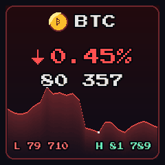<br><sub>Crypto : BTC</sub></td><td align="center">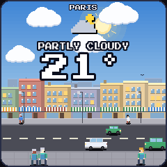<br><sub>Ville, plein jour</sub></td><td align="center">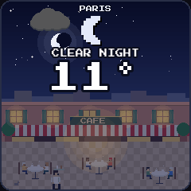<br><sub>Café, de nuit</sub></td><td align="center">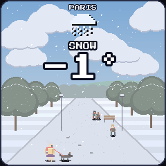<br><sub>Parc sous la neige</sub></td></tr><tr><td align="center">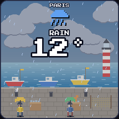<br><sub>Port sous la pluie</sub></td><td align="center">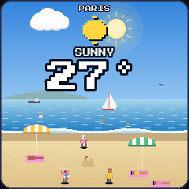<br><sub>Plage au soleil</sub></td><td align="center">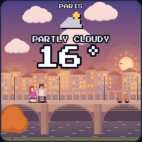<br><sub>Pont au crépuscule</sub></td><td align="center">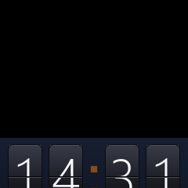<br><sub>Horloge HTC Sense</sub></td></tr></table>

## Ce que ça affiche

- **Cryptos** : une card animée par token (pièce, variation 24 h, prix, sparkline réelle en fond, plus bas et plus haut du jour). Données Binance, secours CoinGecko.
- **Météo** : une scène pixel art plein cadre par lieu, qui change chaque jour parmi 12 décors du quotidien (ville, café, marché, pont, parc, aire de jeux, pique-nique, lac, montagnes, ferme, port, plage) et s'adapte au moment de la journée, à la météo et à la saison. Données Open-Meteo, aucune clé.
- **Horloge** style HTC Sense : tuiles à volets, date, météo animée dessous, effet d'entrée aléatoire.

## Aperçu

Les cards telles qu'elles s'affichent sur l'écran (agrandies x2) :

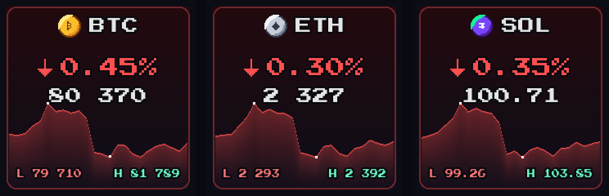

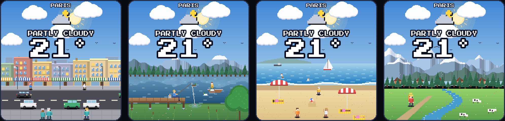

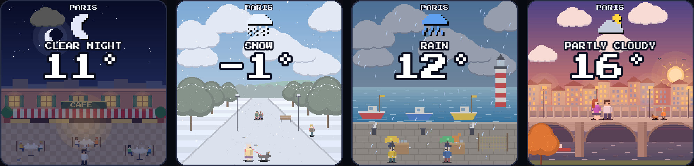

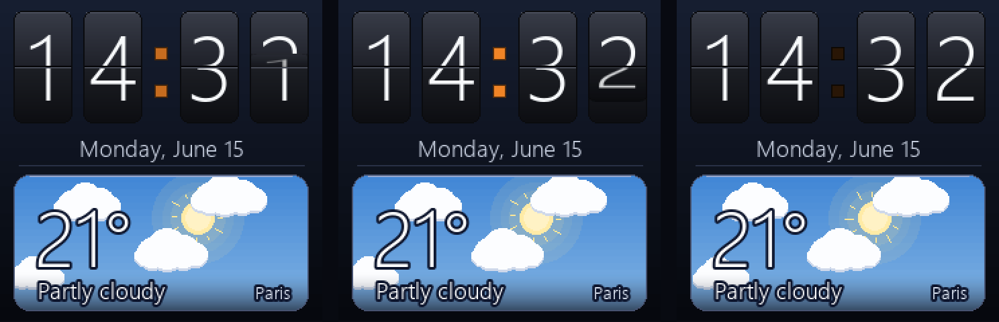

Le backoffice (interface montrée en anglais, disponible aussi en français) :

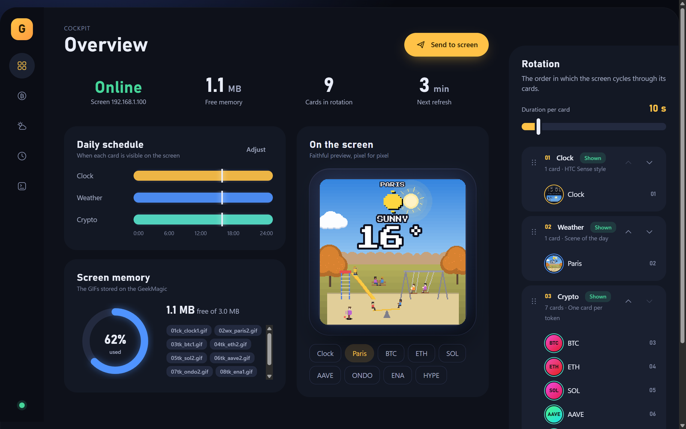

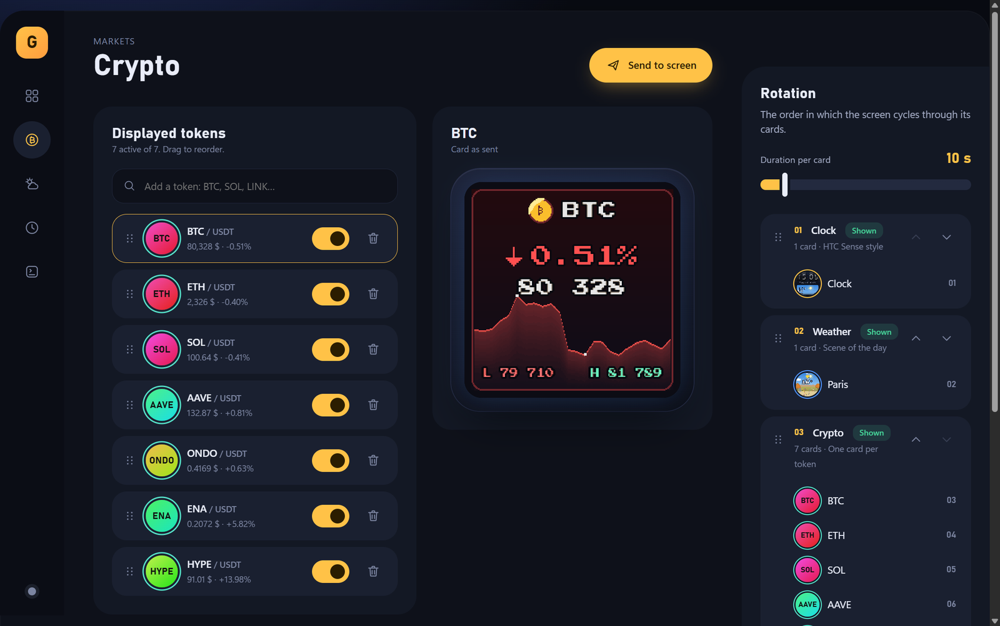

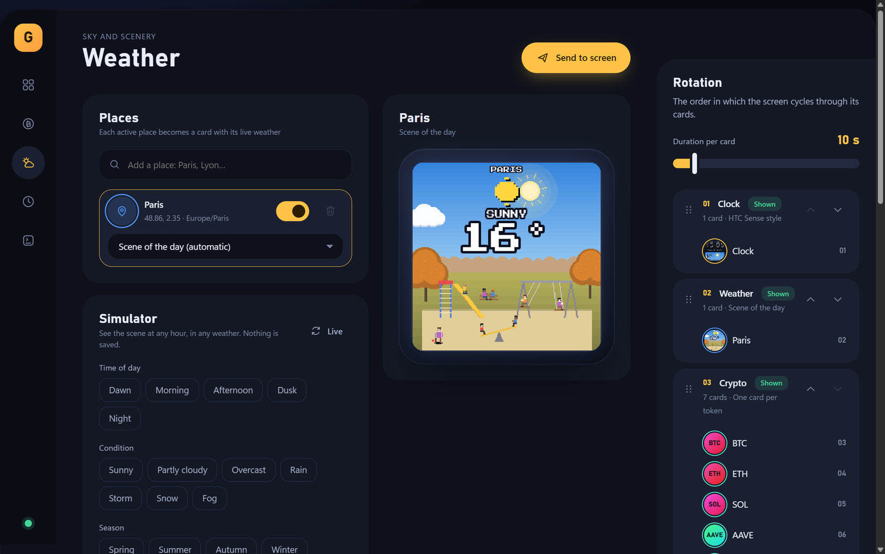

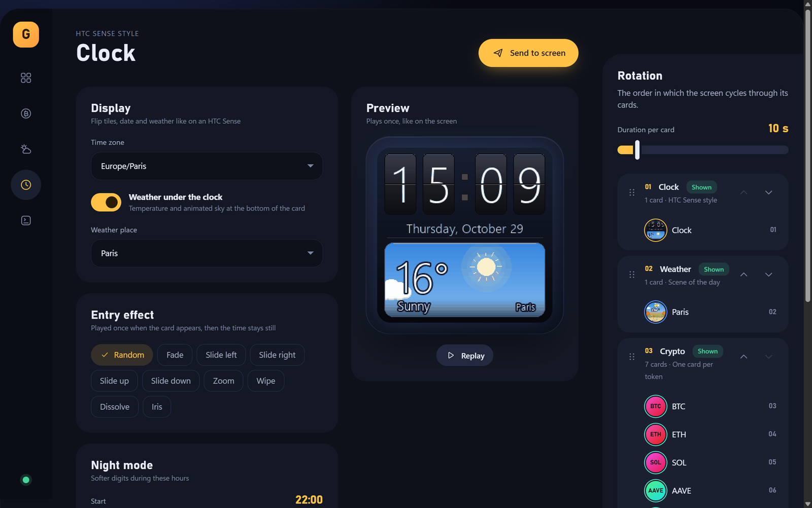

Pour régénérer les captures et les mini écrans : `python scripts/make_screenshots.py` puis `python scripts/make_screenshots.py --gifs`.

## Installation en 3 étapes (Windows)

Prérequis : [Python 3.11+](https://www.python.org/downloads/) (cochez « Add Python to PATH »), Git, et l'écran allumé sur le même réseau Wi-Fi ou Ethernet que le PC.

```bash
git clone https://github.com/lesscro/Geek-Magic-Vibe.git
cd Geek-Magic-Vibe
Installer.bat          # ou : python setup.py
```

L'installateur fait tout : environnement virtuel, dépendances, polices pixel libres, `config.json`, recherche automatique de l'écran sur le réseau, et (si vous acceptez) les tâches planifiées de mise à jour. À la fin, il propose d'ouvrir le backoffice.

Ensuite, au quotidien : double-clic sur **`Lancer le backoffice.bat`**, puis http://localhost:8780. Réglez vos tokens, lieux et créneaux, vérifiez l'aperçu, cliquez sur **Envoyer sur l'écran**.

macOS et Linux : `python setup.py --no-scan` puis `.venv/bin/python backoffice/server.py` (les tâches planifiées sont propres à Windows).

Le backoffice et les textes dessinés sur l'écran existent en **anglais (par défaut) et en français** : changez la langue dans la page Écran et planning.

Si l'écran n'est pas trouvé, saisissez son IP dans le backoffice (page Écran et planning), ou lancez `python scripts/find_device.py`. L'écran doit être sur le même sous-réseau que le PC.

## À quoi sert chaque élément

| Élément | Rôle |
|---|---|
| `Installer.bat`, `setup.py` | Installation guidée, à lancer une fois. |
| `Lancer le backoffice.bat` | Démarre le serveur local et ouvre l'interface. |
| `config.example.json` | Modèle de configuration. `config.json` (votre copie, jamais versionnée) contient votre IP, vos tokens et vos lieux. |
| `backoffice/` | L'interface web de réglage (serveur FastAPI + page HTML/JS). |
| `geekmagic/` | Le moteur : dessin des cards, scènes météo, horloge, envoi vers l'écran. |
| `scripts/` | Commandes : envoi des cards, mise à jour automatique, recherche de l'écran, test, polices. |
| `fonts/`, `output/`, `logs/`, `.venv/` | Créés à l'installation ou à l'usage, non versionnés. |
| `docs/` | Notes de conception (`DESIGN.fr.md`, `PRODUCT.fr.md`, versions anglaises sans suffixe). |
| `CLAUDE.md` | Consignes pour qui développe avec Claude Code (facultatif, sans effet sur l'usage). |

## Mise à jour automatique

Deux tâches planifiées Windows :

```bash
# déjà fait par l'installateur ; à la main (adaptez le chemin) :
schtasks /Create /SC MINUTE /MO 9 /TN GeekMagicDashRefresh /TR "\"C:\chemin\.venv\Scripts\pythonw.exe\" \"C:\chemin\scripts\refresh_all.py\""
efresh_all.py\""
schtasks /Create /SC MINUTE /MO 1 /TN GeekMagicClock /TR "\"C:\chemin\.venv\Scripts\pythonw.exe\" \"C:\chemin\scripts\send_clock.py\""
```

`refresh_all.py` met à jour cryptos et météo selon la cadence et les créneaux du backoffice ; `send_clock.py` garde l'horloge à l'heure. Un verrou (`logs/device.lock`) évite que deux envois se chevauchent.

## Configuration

Tout est dans `config.json` (non versionné). `config.example.json` donne le schéma : écran (IP, cadence), tokens, lieux météo (3 max) et scènes actives, horloge (fuseau, mode nuit, effet), ordre et créneaux horaires de chaque card.

## Architecture

```
backoffice/        serveur FastAPI + interface HTML/JS sans build
geekmagic/
  client.py        client HTTP de l'écran (upload, thème, album, statut)
  pipeline.py      config -> GIF des cards actives -> écran (nettoyage inclus)
  settings.py      défauts, migration, validation, créneaux
  render.py        cards crypto et météo ; clock_sense.py : horloge
  scenes.py        moteur de scènes (ciel, particules, acteurs)
  places*.py       les 12 lieux ; transitions.py : effets d'entrée
scripts/           send_*.py, refresh_all.py, find_device.py, setup_fonts.py
setup.py           installation guidée
```

## Ce qu'il faut savoir sur le matériel

- JPG et GIF uniquement, 240x240. Pas de PNG.
- Un GIF de même nom n'est **pas** écrasé par un nouvel upload : les fichiers alternent entre `…1.gif` et `…2.gif`.
- L'écran est mono-tâche : pas d'envois simultanés. Comptez environ une minute pour un envoi complet.
- Le préfixe numérique des fichiers (`01ck_…`, `03tk_…`) fixe l'ordre de rotation ; l'ordre de lecture par le firmware est à vérifier sur votre modèle.
- Mémoire limitée (environ 3 Mo) : chaque card météo ou horloge pèse environ 200 Ko.

## Crédits

- Protocole de l'écran : travaux communautaires [HelloCubic-Lite](https://github.com/GeekMagicClock/HelloCubic-Lite) et [smalltv](https://github.com/qurle/smalltv).
- Polices pixel : Press Start 2P et Silkscreen (SIL Open Font License), téléchargées par `setup_fonts.py`.
- Données : Binance, CoinGecko, Open-Meteo.

Licence MIT, voir `LICENSE`.
